# JYU
#### Descripción
just a pcap file patented in 1936
#### Adjuntos
secret.pcap
### Desarrollo
El reto presenta una captura de tráfico que hay que analizar.

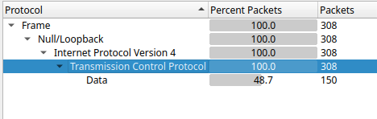

Todo el tráfico es un flujo de datos TCP.

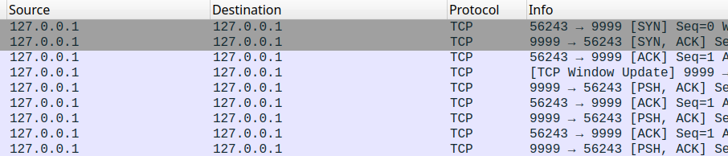

Y ocurre en el mismo host como cliente y servidor P56243 -> P9999.

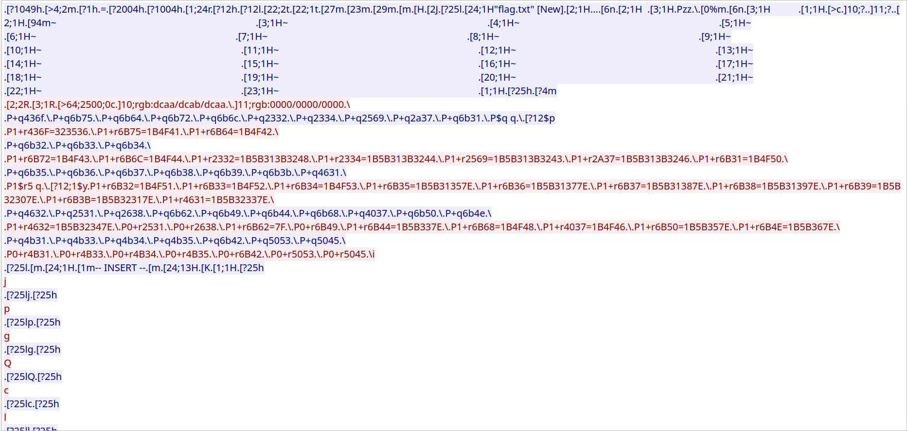

Vemos en la información intercambiada varios caracteres que podrían indicar el formato de impresión en pantalla, como si se tratara de la captura de una consola. No es necesario entender qué representa cada uno de los caracteres, hay varios fragmentos que dan pistas de lo relevante:

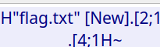

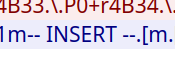

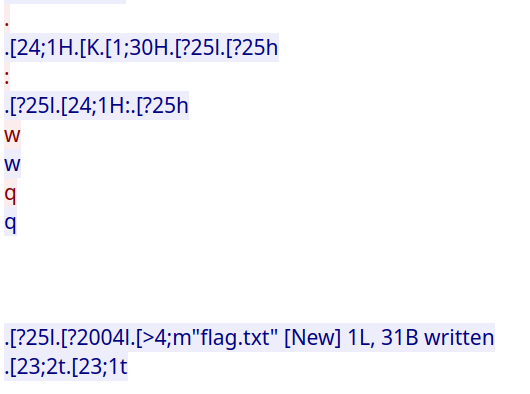

Corresponde con los mensajes impresos por vi y algunos de sus comandos:

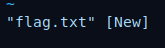

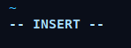

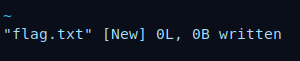

Y el `wq` para escribir el archivo y salir.

Para encontrar la flag hay que reproducir los inputs del cliente, pero en algunos lugares no es tan evidente.

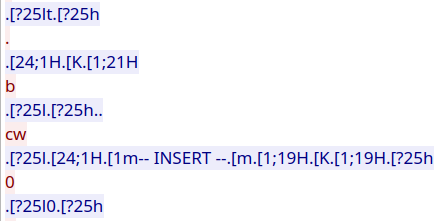

Por el contexto, podemos deducir que `b` y `cw` no es texto que se ingresa, son comandos, principalmente porque se ve que tras el `cw` se pasa a modo insert, y viendo más en detalle, `.` que envía el cliente en realidad es un caracter no imprimible interpretado como un punto por el wireshark.

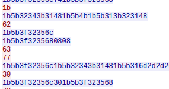

En realidad es `1b`, o `ESC` según indica la tabla ASCII.
Teniendo esto en mente, replicando los inputs con el teclado en vi, el resultado de lo que se ingresa es:
`jpgQcld.p?k1m{b.y,0pt{j4lygp3+`

Y finalmente lo que termina por darle sentido es la descripción "just a pcap file patented in 1936"

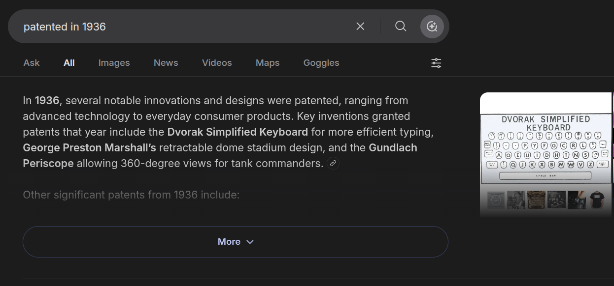

Una búsqueda sugiere que en 1936 se patentó el Dvorak.
Es decir, siguiendo lo que dice la descripción, la flag se escribió con un teclado con el layout en Dvorak.

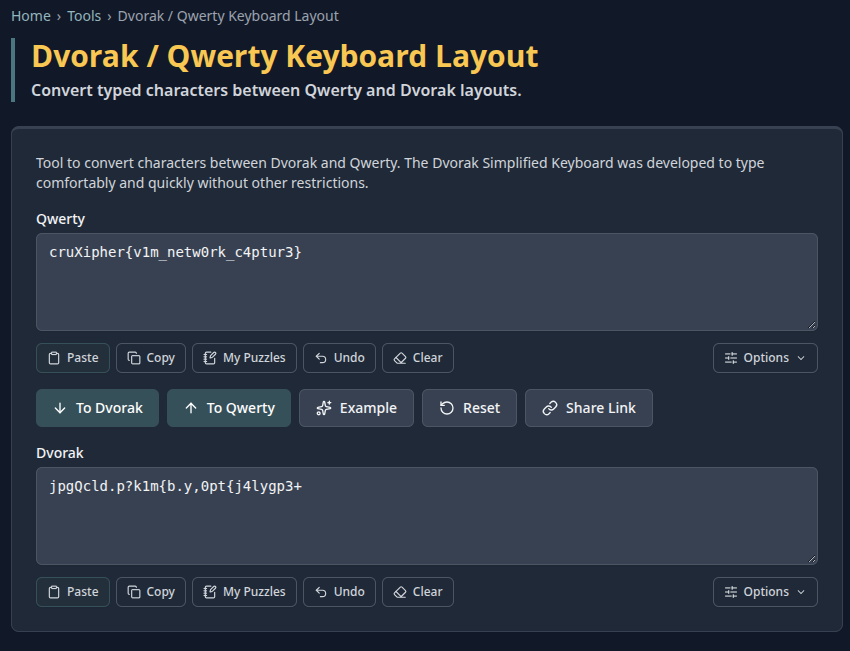

https://www.cachesleuth.com/tools/dvorak/

**Flag**: cruXipher{v1m_netw0rk_c4ptur3}
