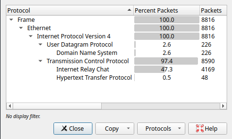
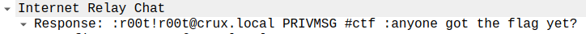
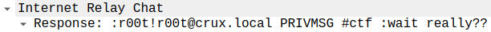
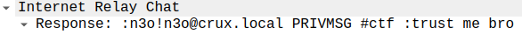
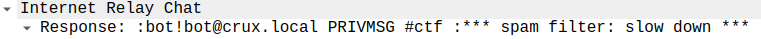
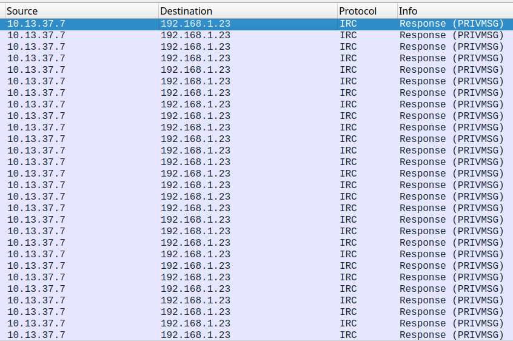
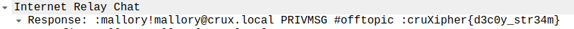
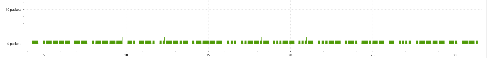
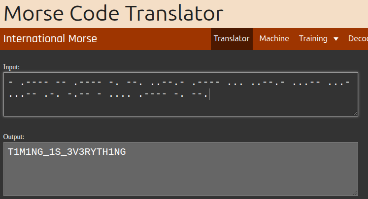

# Wait For It
#### Descripción
just a pcap file
#### Adjuntos
capture.pcap
### Desarrollo
El reto plantea un escenario donde hay que hacer análisis de tráfico con el archivo adjunto que es un .pcap.

Casi la totalidad es IRC y hay algo de HTTP/DNS.

Filtrando en Wireshark por IRC, se observa el siguiente intercambio de mensajes:

Este conjunto de mensajes se repite una y otra vez entre los mismos hosts.

Posteriormente en la captura aparece otro host:

Si filtramos su IP, vemos que tiene su propio conjunto de mensajes que se repiten al igual que los primeros.

Ambas flags son falsas, pero este último deja una pista clave "the flag is in the timing".

Si observamos "el timing" de los paquetes de estos mensajes, podemos ver variaciones en ráfagas entre el tiempo y la cantidad de paquetes que se envían.
Ajustando la vista podemos obtener lo siguiente:

Esto corresponde para el flujo entre los hosts 10.13.37.7 y 192.168.1.42.
No era la flag pero podemos saber que esta bién encaminado porque vimos que estos mensajes transcurrían al mismo tiempo que el primer set y la flag falsa decía "cruXipher{d3c0y_str34m}", haciendo referencia a que es una obfuscación, un "stream señuelo".

Si aplicamos el mismo procedimiento al conjunto de mensajes de los hosts 10.13.37.7 y 192.168.1.23 obtenemos:

https://morsecode.world/international/translator.html

**Flag:** cruXipher{T1M1NG_1S_3V3RYTH1NG}
