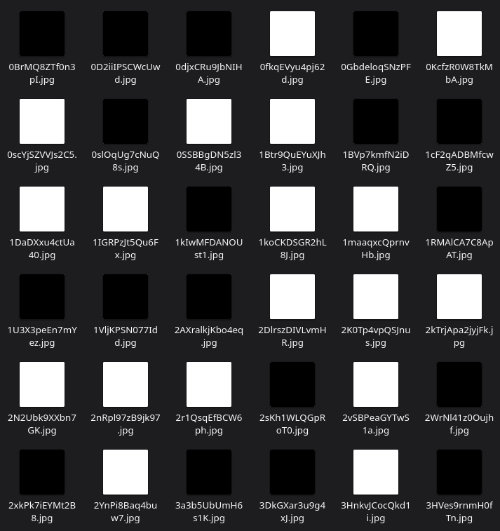
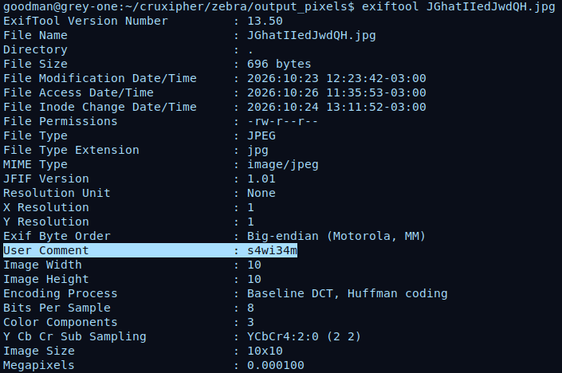
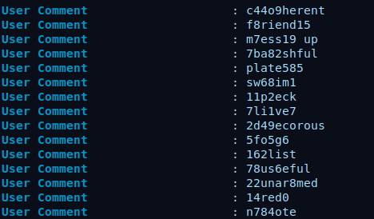
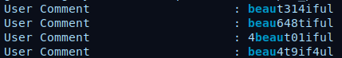
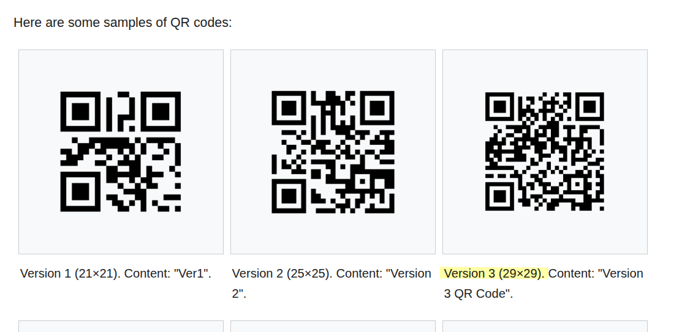
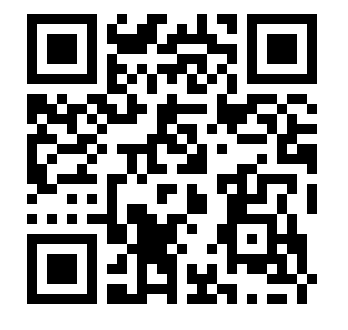

# Zebra
#### Descripción
No cats were harmed during the name of these files
#### Adjuntos
buncharandoms.zip
### Desarrollo
El reto presenta un archivo comprimido `buncharandoms.zip` que tiene un total de 841 imágenes nombradas aleatoriamente: `nRYCKYfHqoh2ve.jpg`, `MfncwDSFMka4zh.jpg`, `0djxCRu9JbNIHA.jpg`...
Revisando algunas arbitrariamente vemos que son cuadrados negros y blancos.

Lo que me llevó a primeras conclusiones suponiendo que puede tratarse de un encoding en binario, blanco=0 negro=1 y viceversa, o morse, sin resultados.

Viendo los metadatos de una de las imágenes se muestra uno en particular se llama User Comment que tiene una combinación de letras y números.

Mostrando varios ejemplos, en algunos es más evidente que en realidad hay palabras:

`c44o9herent` -> coherent

`f8riend15` -> friend

`m7ess19 up` -> mess up

Y muchas se repiten, en cambio, los números son únicos.

`beaut314iful` -> 314

`beau648tiful` -> 648

`4beaut01iful` -> 401

`beau4t9if4ul` -> 494

Y un dato clave dicho al principio es que son en total 841 imágenes, es decir, 29 * 29, al igual que un tipo de qr.

	
[Extraido de Wikipedia](https://en.wikipedia.org/wiki/QR_code)

Concluyendo, las imágenes forman un QR y el número extraido del "User Comment" de sus metadatos indica su posición.
Al generar el qr, la flag esta encodeada en base64.

Se utilizó el script "solve.py" de este directorio para reconstruirlo.

**Flag**: cruXipher{1_l0v3_3x1f_m3t4dat4}
